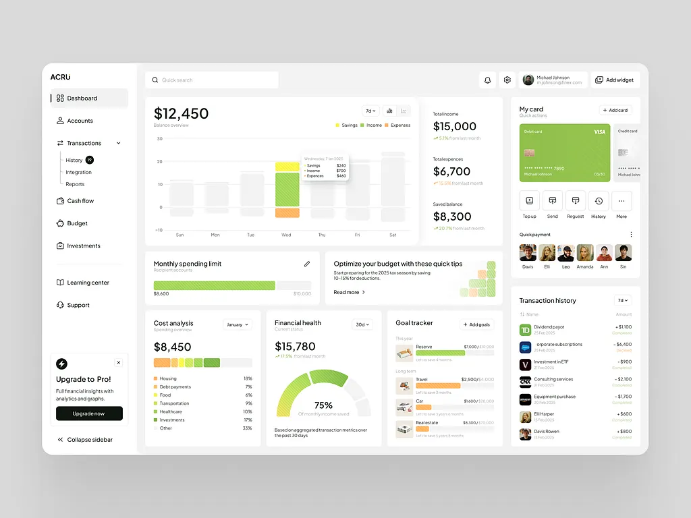
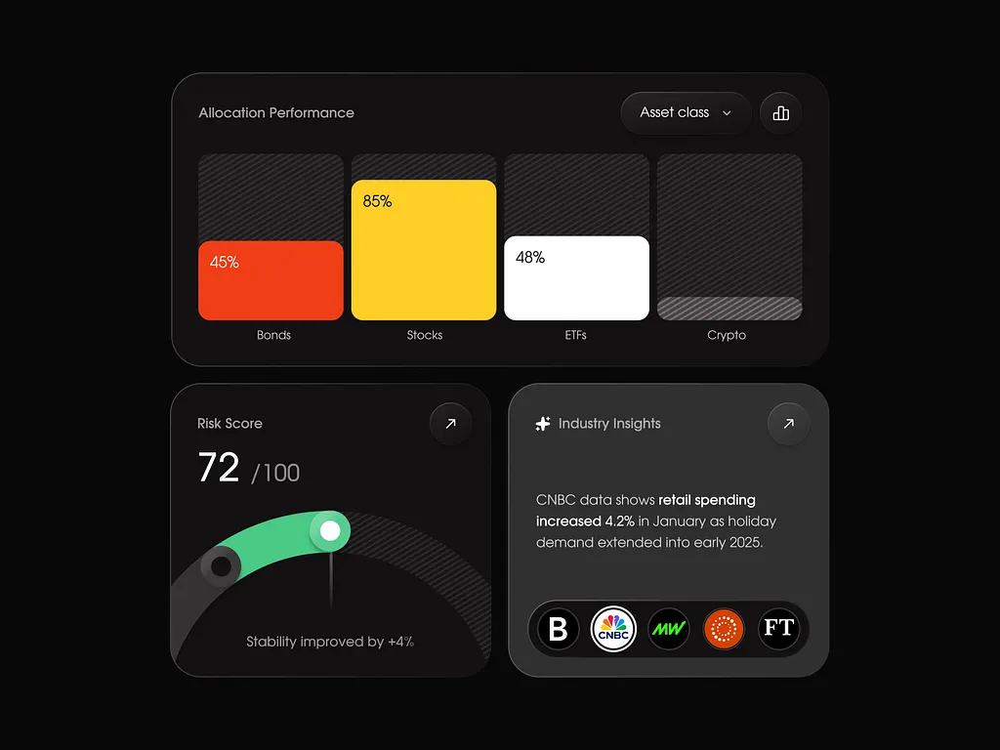
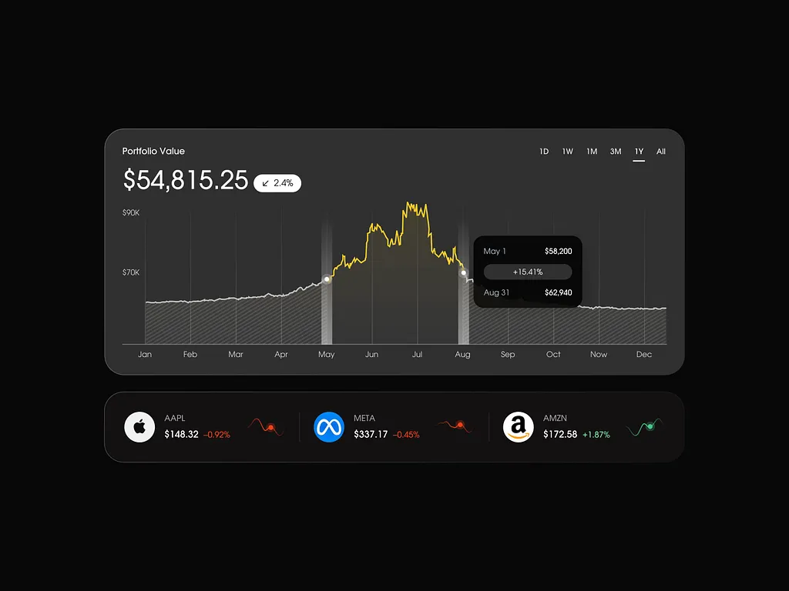
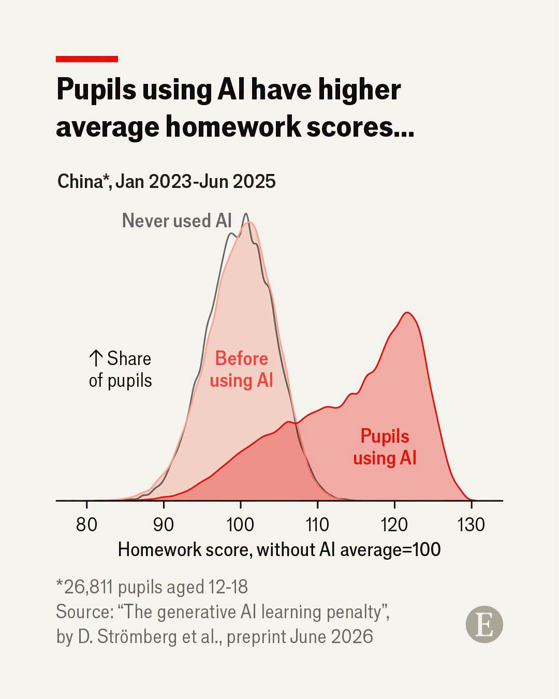
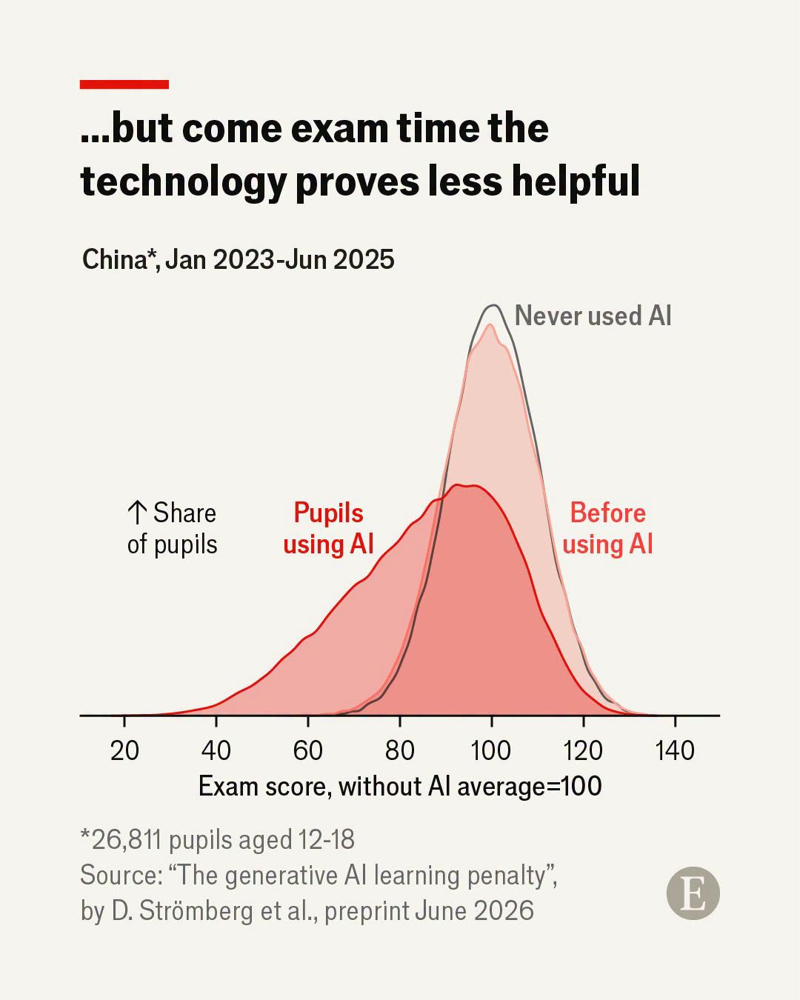

```{r setup, include=FALSE}
knitr::opts_chunk$set(echo = TRUE)
```

## Load required packages

```{r}
#| echo: true
#| warning: false

library(tidyverse) 
# if you're using macOS: library(dplyr)
library(skimr)
```

## Dashboard

- A combination of some plots to show a story
  - Real-time
  - Insights
- Dashboard vs a plot

## Example 1: Finance Management dashboard



## Example 2: Finance portfolio (1)



## Example 2: Finance portfolio (2)



## Example 3: Wealth Inequality at a Glance

Sometimes, we can build a dynamic dashboard: [Link](https://inequality-final.streamlit.app/)

## Storytelling plot

There are some good examples that a plot can tell a good story than many pages of words.

One recent example I found is from the Economist magazine.

## First, AI usage and homework score



## Next, AI usage and exam scores



## Layout of a dashboard

- Column vs rows

- Sidebar

- Tabset: like tabs in Chrome web browser ([read here](https://quarto.org/docs/dashboards/layout.html#tabsets))

## Input

- Plot

- Table

- Number

- Text

## Steps to make a dashboard

1.  Think which contents to show to audience: a story
2.  Design layout
3.  Put contents to layout
    1.  For plot: suggest to use interactive plot like `plotly`
    2.  For table: use `DT` table
4.  Change theme colors
5.  Deployment or publish the dashboard online

## Create a new quarto with these options on top

```{r}
#| eval: false
---
title: "An awesome dashboard"
author: "Richard"
format: dashboard
---


```

## Practice

- Imagine that we have three plots: f1, f2, f3

- We made it in data visualization lecture

- Let's discuss with your friends how to put them to a dashboard

## Design a layout

- Refer to this website: [Layout](https://quarto.org/docs/dashboards/layout.html)

- Use your three plots

- Make the dashboard as beautiful as possible

  - A story

## Themes

- You can choose up to 25 different themes: [read here](https://quarto.org/docs/dashboards/theming.html)

  - Add the `theme` option with corresponding theme choice on the top

- Or customize a new one based on CSS

```{r}
#| eval: false

format:
  dashboard:
    theme: united
```

## Complete it

- Let me show my dashboard first

  - In file `dashboard-example.qmd`

- OK, let's work to make it and show me the results
